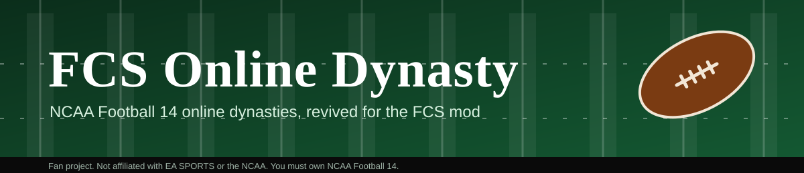
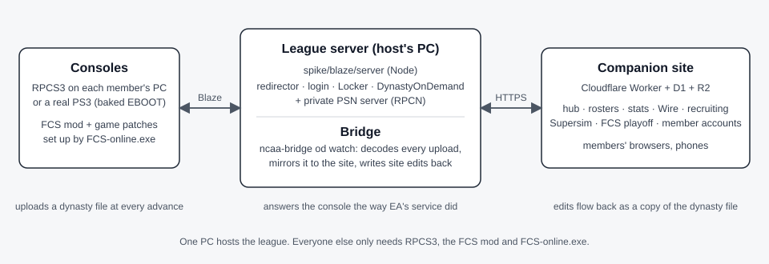

  
  
  
  
  

**Online Dynasty for NCAA Football 14 is back, for the FCS mod.** One PC runs the league server that EA switched
off; every member's RPCS3 (or a real PS3) plays its online dynasty against it, and a companion website mirrors the
league live. The game itself gets patches on the way: jersey #0, 100-player rosters with a 90-man season limit, and
crash fixes.

## Quick start

**Join a league (member)**

1. Install RPCS3 and the FCS mod as usual, then run `FCS-online.exe` and pick **1 Join**. Enter the host's address
   when asked. It installs and enables the game patches, the stop-gap uniform files, and points RPCS3 at the league.
2. In RPCS3: Configuration → RPCN → **Create Account** (any email, the token the host gives you) → Test.
3. Start the game, Online Dynasty, join the league's dynasty. Create your account on the
   [companion site](https://ncaa-online.foxbros.workers.dev) and give the commissioner your username.

**Host a league**

1. `git clone` this repo, `npm install` (Node 20+).
2. Run a private PSN server (RPCN) once: see [spike/blaze/README.md](spike/blaze/README.md).
3. `spike\blaze\server\start-league.cmd` starts everything (redirector, Blaze stub, Locker, site sync);
   `FCS-online.exe host` does the same from a checkout. `league-status.cmd` shows the services.
4. Give members your address and an RPCN token. Build their installer with
   `npm run build:installer -- --roster <save folder>`.

**Develop**: `npm test` (codec, bridge, worker), `cd worker && npx wrangler dev`, `npm run build:installer`.

## Features

| | Feature | What it does | Where |
|---|---|---|---|
|  | **League server** | Answers the console like EA's Blaze service did: redirector, login, Locker file store, DynastyOnDemand (create, join, advance, play, upload). Proven on RPCS3 and a private RPCN. | `spike/blaze/server` |
|  | **Companion site** | Hub, schedule, standings, rankings, rosters, depth charts, players, stats, awards, recruiting, transfer portal, member accounts with invite codes. Updated seconds after every advance. | `worker` |
|  | **Dynasty Wire** | Season stories, headshots (the league's own photo sets or the game's face art), logos for every FCS team and conference. | `worker`, `bridge` |
|  | **Site → console** | Prospect edits, depth charts, portal transfers, start year, recruit-class overhaul (Fang's tool), commissioner recruit locks. Delivered as change tables or a copy of the dynasty file the console takes at its next load. | `bridge` |
|  | **Supersim coaching** | Call every play of your own game from the team's real NCAA 14 playbook; 22 players animated from the play art; the final is an official league result. Anyone signed in can watch live. | `worker/src/supersim` |
|  | **FCS playoff** | A 24-team bracket (auto bids + polls) played on the site while the console sits at Bowl Season, then written into the game's bowl rows. The server holds the console's advance until the copy is loaded. | `bridge/src/playoff.ts` |
|  | **Game patches** | Preseason All-Conference crash fix · five dynasties per commissioner · **jersey #0** · **100-player rosters**: ids re-keyed to 100 per team, up to 99 on a roster, 90 kept after the Cut Players week, 70 dress per game. RPCS3 yml entries, generated from the executable. | `spike/blaze/tools` |
|  | **Real PS3** | The same patch words baked into the game's EBOOT for a console without PSN. | `spike/blaze/tools/ps3-eboot.mjs`, `docs/ps3-no-psn-research.md` |
|  | **Rosters** | A 90-man FCS 2026 roster save (ships in the installer); `roster grow` re-keys any save to 100 per team; `od players` / `od repair` fill or restore a team through the dynasty-file copy. The league server completes every uploaded team package so big rosters survive the advance. | `bridge`, `spike/blaze/server/team-package.mjs` |
|  | **Uniforms** | FCS Uniform Studio (edit what every team wears, textures included) and stop-gap sets for the slots whose art the mod does not ship, which otherwise crash a game. | `spike/blaze/tools/uniforms` |
|  | **FCS-online.exe** | One executable, console wizard, no admin rights: join / roster / host / status. Backs up every file it changes. | `installer` |
|  | **Save codec** | EA "DB" save format read, verify and write with the full CRC chain; NCAA 14 table semantics, decoders and roster helpers shared by the bridge, the site and the tools. | `packages/tdb`, `packages/ncaa14` |

## Repository

| Path | Contents |
|---|---|
| `installer/` | FCS-online.exe source and build (Node single executable) |
| `spike/blaze/server/` | the league server and its start/stop/status scripts |
| `spike/blaze/tools/` | patch generators, EBOOT bake, uniform studio, roster patch inventory |
| `bridge/` | `ncaa-bridge`: the PC-side sync and edit delivery (`od watch`, `od import`, `od players`, `od repair`, `roster grow`) |
| `worker/` | the companion site and API (Cloudflare Worker, D1, R2) |
| `packages/tdb`, `packages/ncaa14`, `packages/sim` | save codec, game semantics, SuperSim engine |
| `docs/` | research and runbooks: [roster patch inventory](docs/roster-stride-inventory.md), [PS3 without PSN](docs/ps3-no-psn-research.md), [tables](docs/tables.md), [playbooks](docs/playbooks.md), [site reference](docs/site-reference.md) |
| `spike/blaze/NOTES.md` | the day-by-day research log |

`spike/blaze/private/` (saves, captures, anything derived from the game binary) and the generated installer payload are
never committed. The patch yml entries are generated locally from your own copy of the game.

## Status

Playing weekly on RPCS3 with the FCS mod: online dynasty, site mirror, Supersim, the playoff, jersey #0, 99-man CPU
and 90-man member rosters all verified in game. Still open: the Cut Players week at 90 (needs an offseason), a
member's own-team package above 70 on a real PS3, password reset for site accounts.

---

Fan passion project. Not affiliated with, endorsed by, or sponsored by Electronic Arts, EA SPORTS, the NCAA, or any
school or conference. Not monetized. You must own NCAA Football 14 to use any of this. The FCS mod is FloridaMan's
work; Fang's Recruit Overhaul and RPCN are their authors' and are not included here.
