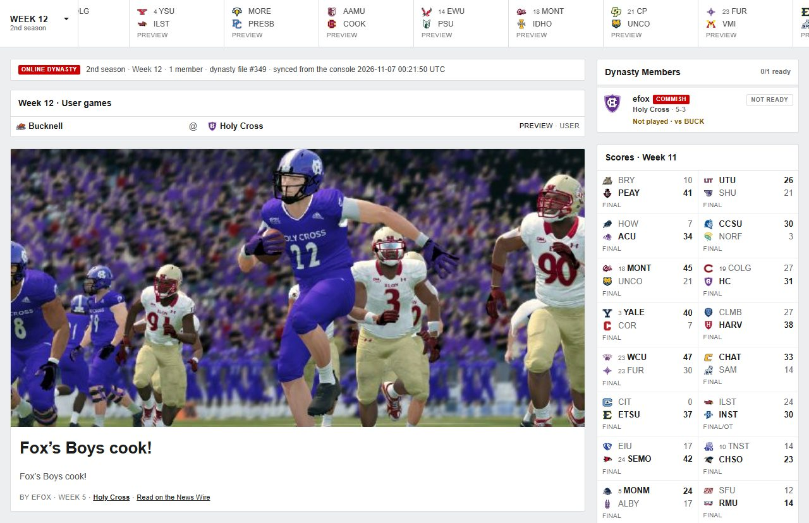

# FCS Online Dynasty

Play **NCAA Football 14 Online Dynasty** again, with TheFloridaMan's FCS mod. One person in the league runs a small
server on their PC that stands in for EA's old online service; everyone else connects to it from RPCS3. A league
website at **[fcs-mod.online](https://fcs-mod.online)** follows along: scores, standings, rosters, stats, recruiting and
news update every time the league advances a week.

<p align="center">
  <a href="https://github.com/ericfox5/fcs-mod-companion/releases/latest"></a>
</p>

<p align="center">
  <a href="https://fcs-mod.online"></a>
  
  
  
</p>

<p align="center"></p>

## What you get

- **Online Dynasty works again.** Create a league, join it, play your games and advance weeks, just like before EA shut
  the servers down.
- **A league website.** Every member gets an account on [fcs-mod.online](https://fcs-mod.online) with the league's
  schedule, scores, rankings, rosters, depth charts, player stats, awards, recruiting boards and news stories.
- **90-man rosters.** Teams carry 90 players during the season (up to 99 in the offseason, then cut back to 90),
  instead of the game's usual 70. 70 still dress for each game.
- **The 2026 FCS roster**, with up to 90 real players per team.
- **Fixes for the FCS mod:** jersey #0, a crash when the season rolls over, a freeze at "generating recruits" caused by
  long snappers, and stand-in uniforms for teams whose uniforms the mod doesn't include yet (without them, games
  involving those teams crash).

<p align="center"></p>

## Install

You need: a Windows PC, NCAA Football 14 for PS3 with TheFloridaMan's FCS mod installed in **RPCS3 version 0.0.29
(build 15767)**. Newer RPCS3 versions crash when a game starts loading.

1. Close RPCS3.
2. Download **FCS-online.exe** from the [latest release](https://github.com/ericfox5/fcs-mod-companion/releases/latest)
   and double-click it. If Windows says "Windows protected your PC", click **More info**, then **Run anyway**.
3. Press **Enter** to choose **1. Install or update**, and **Enter** again to use the RPCS3 folder it finds.
4. Start the game and load the roster **ROSTER-FCS2026**.

To update, download the newest FCS-online.exe and run it again. Everything it replaces is backed up first, in
`%LOCALAPPDATA%\ncaa-bridge`.

## Join a league

1. Run **FCS-online.exe** (see [Install](#install)) and choose **2. Join an online league**. Type the address your
   league's host gives you. It installs everything **1. Install or update** does, then points RPCS3 at the league.
2. In RPCS3, open **Configuration → RPCN → Create Account**. Use any email and the token your host gives you, then
   press **Test**.
3. Start the game and go to **Online Dynasty** to join your league's dynasty.
4. Sign up at [fcs-mod.online](https://fcs-mod.online) and send your username to the commissioner.

Run the newest FCS-online.exe again whenever there's a new release. It updates what changed, and it backs up each
file before changing it.

## Host a league

1. Install [Node.js](https://nodejs.org) 20 or newer and Git, then:
   ```
   git clone https://github.com/ericfox5/fcs-mod-companion
   cd fcs-mod-companion
   npm install
   ```
2. Set up the private RPCN server once (the free PSN replacement RPCS3 uses): see
   [spike/blaze/README.md](spike/blaze/README.md).
3. Start the league with `spike\blaze\server\start-league.cmd`. `league-status.cmd` shows what is running and
   `stop-league.cmd` stops it.
4. Build the installer and publish it as a GitHub release (needs the [GitHub CLI](https://cli.github.com), logged
   in). Then send your players your address and an RPCN token:
   ```
   npm run release
   ```
   It builds `installer\dist\FCS-online.exe` and uploads it with the install guide (`installer\RELEASE.md`) as
   the release notes. `npm run build:installer -- --roster "<save folder>"` only builds it.

## Game patches

FCS-online.exe adds these to RPCS3 and turns them on. They are needed by every player in the league.

| Patch | What it does |
|---|---|
| FCS mod: preseason All-Conference crash fix | Stops the crash at "Generating All-Americans" when a season rolls over |
| Online Dynasty: commissioner of up to 5 dynasties | Lets one person run up to five online dynasties |
| FCS mod: jersey #0 | Lets players wear #0 |
| FCS mod: 100-player rosters (and its capacity, player table and offseason parts) | 90-man rosters everywhere: the Rosters screen, new dynasties, games and the offseason |
| FCS mod: long snapper recruiting fix | Stops the freeze at "generating recruits" |
| FCS mod: generic opponents host | In Custom Schedules, games against the generic teams can be home or away |

## For developers

- `npm test` runs the tests. `cd worker && npx wrangler dev` runs the website locally.
- [docs/roster-stride-inventory.md](docs/roster-stride-inventory.md) explains how the roster patches were built;
  [spike/blaze/NOTES.md](spike/blaze/NOTES.md) is the full research log.

| Folder | What's in it |
|---|---|
| `installer/` | FCS-online.exe |
| `spike/blaze/server/` | the league server |
| `spike/blaze/tools/` | patch generators and the uniform editor |
| `bridge/` | syncs each league's data to the website and sends website edits back to the game |
| `worker/` | the website |
| `packages/` | reading and writing the game's save files |

Game data, saves and anything taken from the game's files stay out of this repository. The patches are generated
from your own copy of the game.

---

Fan project. Not affiliated with, endorsed by, or sponsored by Electronic Arts, EA SPORTS, the NCAA, or any school or
conference. Not monetized. You must own NCAA Football 14 to use any of this. The FCS mod is TheFloridaMan's work;
RPCN and other tools belong to their authors and are not included here.
